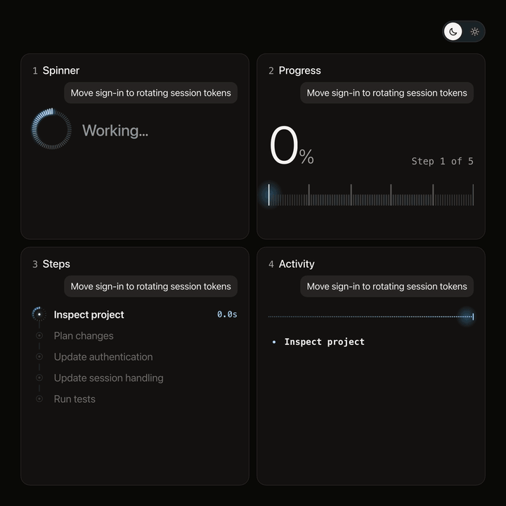

# Beautiful UI

Follow [@sebastianbennis on X](https://x.com/sebastianbennis) to see each new one first.

Interface components designed and coded from scratch. Take one into your project and make it yours. New ones land here as they are finished, so star or watch this repo to keep up.

## The collection

<table>
  <tr>
    <td width="50%" valign="top">
      <a href="components/agent-progress"></a>
      <h3><a href="components/agent-progress">Agent progress</a></h3>
      Four ways to show an AI agent is working, in dark and light.
    </td>
    <td width="50%" valign="middle" align="center">
      More on the way.<br>
      <a href="https://x.com/sebastianbennis">Follow on X</a> to see the next one first.
    </td>
  </tr>
</table>

## Install

Every UI installs the same way, with its name at the end:

```bash
# npm
npx shadcn@latest add sebastianbennis/beautiful-ui/agent-progress

# pnpm
pnpm dlx shadcn@latest add sebastianbennis/beautiful-ui/agent-progress

# Yarn
yarn dlx shadcn@latest add sebastianbennis/beautiful-ui/agent-progress

# Bun
bunx --bun shadcn@latest add sebastianbennis/beautiful-ui/agent-progress
```

The files land in `components/<name>`, or `src/components/<name>` if your project has a `src` folder. You don't need shadcn/ui or Tailwind.

To do it by hand, open a UI's folder and copy everything in its `src` folder into your project.

Working with Claude Code, Cursor or another AI coding tool? Point it at a UI's folder and ask it to add that UI to your project.

## License

MIT. Free to use in anything, as long as the license stays with the code.
