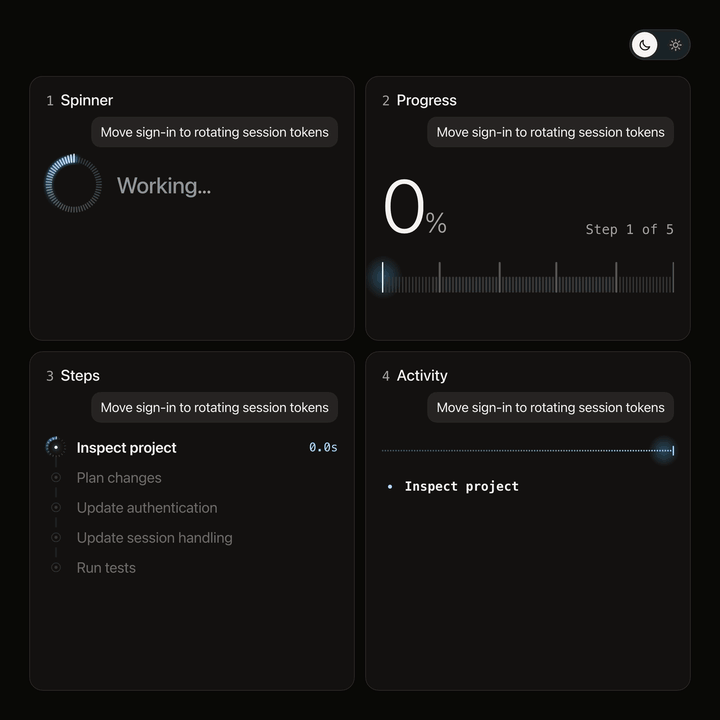

# Agent progress

Follow [@sebastianbennis on X](https://x.com/sebastianbennis) to see each new one first.



Four ways to show an AI agent is working: a spinner, a progress reading, a list of steps and a live activity log. Dark and light themes are built in.

It needs React and nothing else. There is no build step, no CSS framework and no icon set.

## Install

```bash
# npm
npx shadcn@latest add sebastianbennis/beautiful-ui/agent-progress

# pnpm
pnpm dlx shadcn@latest add sebastianbennis/beautiful-ui/agent-progress

# Yarn
yarn dlx shadcn@latest add sebastianbennis/beautiful-ui/agent-progress

# Bun
bunx --bun shadcn@latest add sebastianbennis/beautiful-ui/agent-progress
```

The files land in `components/agent-progress`, or `src/components/agent-progress` if your project has a `src` folder. You don't need shadcn/ui or Tailwind.

To do it by hand, copy everything in the [`src`](./src) folder into a folder called `agent-progress` in your project. Either way, the code is yours to change.

## Use it

Wrap your agent UI in `AgentUI`, then give each component plain data from your own run.

```tsx
import { AgentProgress, AgentSpinner, AgentSteps, AgentUI } from './components/agent-progress';

<AgentUI theme="dark">
  <AgentSpinner status="running" />
  <AgentProgress status="running" progress={0.42} steps={5} detail="Step 3 of 5" />
  <AgentSteps
    status="running"
    steps={[
      { id: 'read', label: 'Read the codebase', state: 'done', note: '1.9s' },
      { id: 'edit', label: 'Update session handling', state: 'current' },
      { id: 'test', label: 'Run tests', state: 'pending' },
    ]}
  />
</AgentUI>;
```

## The components

| Component | Answers | Main props |
| --- | --- | --- |
| `AgentSpinner` | Is it still working? | `status`, `words` |
| `AgentProgress` | How far along is it? | `status`, `progress` (0 to 1), `steps`, `detail`, `label`, `ticks` |
| `AgentSteps` | What is it doing, and what is left? | `status`, `steps`, `within` (0 to 1) |
| `AgentActivity` | What exactly just happened? | `status`, `events`, `now`, `rows`, `ticks` |
| `ThemeSwitch` | A dark and light control | `theme`, `onThemeChange` |

`status` is `idle`, `running`, `complete` or `failed`. The types are in `types.ts`.

`AgentActivity` needs the time since the run started. If you have no clock of your own, use the hook:

```tsx
const now = useRunClock(status === 'running');

<AgentActivity status={status} events={events} now={now} />;
```

`Bezel`, `StepMark` and `Odometer` are exported too, if you want the parts on their own.

## Theme

Hold the theme in your app and pass it down. `ThemeSwitch` is optional, so a theme setting you already have works just as well.

```tsx
const [theme, setTheme] = useState<AgentTheme>('dark');

<AgentUI theme={theme}>
  <ThemeSwitch theme={theme} onThemeChange={setTheme} />
</AgentUI>;
```

Changing the theme fades every colour together.

## Make it yours

Every colour is a token at the top of `agent.css`. Any rule of yours overrides them, because the defaults carry no specificity.

```css
.my-chat .agent-ui {
  --agent-live: #7c5cff;
  --agent-live-hot: #e6deff;
  --agent-sheen: #e6deff;
  --agent-surface: #101014;
}
```

| Token | What it colours |
| --- | --- |
| `--agent-surface` | The background the components sit on |
| `--agent-ink`, `--agent-ink-soft` | Main and secondary text |
| `--agent-live`, `--agent-live-hot` | Work in progress, and its brightest point |
| `--agent-sheen`, `--agent-wave` | The sweep across the current step, and the resting letters of the spinner word |
| `--agent-halo`, `--agent-glow` | The soft light around the spinner and the moving edge |
| `--agent-ok`, `--agent-bad` | Success and failure |
| `--agent-track`, `--agent-track-soft`, `--agent-track-major` | Unlit ticks, the steps rail, and the tall graduations |

**Size.** `<AgentUI scale={0.6}>` resizes the whole set in proportion, or set `--agent-u` yourself. It can follow a container too: `--agent-u: calc(100cqw / 540)`.

**Type.** Text uses your page's font. Set `--agent-font-mono` to change the numbers and the log.

**Motion.** The curves and the theme fade are tokens as well. With reduced motion on, every state still appears and nothing travels.

**Pace of the number.** `Odometer` changes at most every 240ms, however often the value updates, so it stays readable. Change it with `cadenceMs`.
