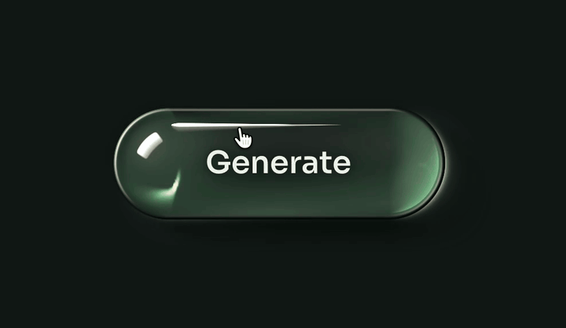

# Crystal button

Follow [@sebastianbennis on X](https://x.com/sebastianbennis) to see each new one first.



A Generate button for anything that takes a while to make something. It is one solid piece of clear crystal lying on the page, round over the top like a marble. Your pointer is a lamp. Press it and the crystal comes apart into cells, the way tissue looks under a microscope, in a wave that starts where you pressed. The light goes from cell to cell while the job runs, and when the job is done the cells close up and the one crystal is full of light.

It needs React 18 or newer and nothing else. There is no build step, no CSS framework, no icon set and no image. The glass, its reflections, its shadow and the light it throws on the page are drawn in code with WebGL2, with a body drawn in CSS for browsers that lack it.

It runs your own job. Hand it a promise, or drive it yourself with a status.

## Install

```bash
# npm
npx shadcn@latest add sebastianbennis/beautiful-ui/crystal-button

# pnpm
pnpm dlx shadcn@latest add sebastianbennis/beautiful-ui/crystal-button

# Yarn
yarn dlx shadcn@latest add sebastianbennis/beautiful-ui/crystal-button

# Bun
bunx --bun shadcn@latest add sebastianbennis/beautiful-ui/crystal-button
```

The files land in `components/crystal-button`, or `src/components/crystal-button` if your project has a `src` folder. You don't need shadcn/ui or Tailwind.

To do it by hand, copy everything in the [`src`](./src) folder into a folder called `crystal-button` in your project. Either way, the code is yours to change.

## Use it

Return your job's promise from `onGenerate` and the button runs itself: working until the promise settles, then "Done" or "Try again", then back to rest.

```tsx
import { GenerateButton } from './components/crystal-button';

export function Composer() {
  return <GenerateButton onGenerate={() => fetch('/api/generate', { method: 'POST' })} />;
}
```

A promise that rejects shows "Try again". `fetch` only rejects when the network fails, so throw for a bad response if you want that to count as a failure.

To drive it yourself, pass `status`. Add `progress` if your job can say how far along it is, and `onStop` if it can be stopped. With `onStop`, the working word reads "Stop" and a press while working calls it.

```tsx
import { useRef, useState } from 'react';
import { GenerateButton, type GenerateStatus } from './components/crystal-button';

export function Composer() {
  const [status, setStatus] = useState<GenerateStatus>('idle');
  const [progress, setProgress] = useState(0);
  const job = useRef<AbortController | null>(null);

  async function start() {
    const control = new AbortController();
    job.current = control;
    setStatus('working');
    setProgress(0);
    try {
      for (let step = 1; step <= 8; step++) {
        const reply = await fetch(`/api/generate?step=${step}`, { method: 'POST', signal: control.signal });
        if (!reply.ok) throw new Error('The step failed');
        setProgress(step / 8);
      }
      setStatus('done');
      window.setTimeout(() => setStatus('idle'), 1800);
    } catch {
      // A job that was stopped is back at rest already.
      if (!control.signal.aborted) setStatus('failed');
    }
  }

  return (
    <GenerateButton
      status={status}
      progress={status === 'working' ? progress : undefined}
      onGenerate={start}
      onStop={() => {
        job.current?.abort();
        setStatus('idle');
      }}
    />
  );
}
```

## The components

There is one component, `GenerateButton`. It renders a real `<button>`, with a status line beside it for screen readers.

| Prop | What it does |
| --- | --- |
| `onGenerate(event)` | Called when the button is pressed at rest. Return a promise and the button follows it. Return nothing and give no `status`, and the button stays at rest. |
| `onStop()` | Called when the button is pressed while working. Giving it makes the job stoppable, and the working word becomes "Stop". Without it the button cannot be pressed while it works. |
| `status` | `'idle'`, `'working'`, `'done'` or `'failed'`. Set it to drive the button yourself. Leave it out and the button follows `onGenerate`'s promise. |
| `progress` | From 0 to 1: that share of the cells stays lit. Leave it out and they fill slowly on their own, never past a little over half, so the button does not claim more than it knows. |
| `labels` | The words: `{ idle, working, stop, done, failed }`. Any you leave out keep their default, listed below. |
| `theme` | `'light'` or `'dark'`. Left out, it follows the system. See Theme below. |
| `seed` | A number. The same seed always gives the same cells. Left out, it comes from where the button was pressed, so each press has its own pattern. |
| `settleMs` | How long "Done" and "Try again" stay up before the button rests again, when it runs itself. Default 1800. |
| `disabled` | Frosted glass that mirrors nothing, with dim words. |
| `className` | Added to the button, beside `caughtlight`. This is where your own tokens go. |
| Everything else | Any ordinary button attribute is passed through, and the ref is the `<button>`. `children` and `onClick` are not taken: the words come from `labels`, and a press calls `onGenerate` or `onStop`. |

The words, and when each shows:

| Label | Default | When |
| --- | --- | --- |
| `idle` | Generate | At rest |
| `working` | Generating | While the job runs and cannot be stopped. It is also what a screen reader hears when any job starts |
| `stop` | Stop | While the job runs and `onStop` is given |
| `done` | Done | After the job finishes |
| `failed` | Try again | After the job fails. Pressing it calls `onGenerate` again |

Also exported: the types `GenerateButtonProps`, `GenerateLabels` and `GenerateStatus`.

What someone sees as they use it:

| Moment | What happens |
| --- | --- |
| At rest | The glass mirrors a window on its shoulder and a long stroke of light along its top. At its far end the page's light gathers in one clean crescent against the wall, the bright edge you see on the far side of a glass marble. |
| The pointer comes near | The pointer is a lamp. Fine curves of light swing inside the glass, the curves you see inside a ring or a coffee cup. The glass brightens a little under the pointer, and light lands on the page on the side away from it. It starts before the pointer reaches the button. |
| It is pressed | The body sinks on a spring, the lamp comes down until it all but touches the glass, and a point of light gathers under it. |
| It is let go | The crystal comes apart. Furrows open in a wave that starts at the point that was pressed, with light racing through them as they open, and every cell rounds off into a small crystal with its own reflections. |
| The job runs | The light goes from cell to cell, there and back. The cells the job has got to stay lit, so with `progress` you can read how far along it is. |
| Done | The light floods out from where the button was pressed, the cells close up behind it, and the one crystal is full of light. The word turns dark so it reads on the light. |
| Failed | The light goes out, the cells close, and the word reads "Try again" in a warm colour. |
| Stopped | The light goes out and the cells close up into one piece. |
| Keyboard focus | The edge of the glass carries light all the way round, with a ring outside it. |
| Disabled | Frosted glass. It does not answer the pointer. |

## Theme

Dark is deep jade glass on a dark page, where the glass shows by its highlights and the light it holds. Light is paler jade on a pale page, where it mirrors a bright room and throws a shadow you can see. Each is drawn on its own terms.

```tsx
<GenerateButton theme="light" onGenerate={start} />
```

Leave `theme` out and it follows the system setting, and changes with it. To let people choose:

```tsx
const [theme, setTheme] = useState<'light' | 'dark'>('dark');

<button type="button" onClick={() => setTheme(theme === 'dark' ? 'light' : 'dark')}>
  {theme === 'dark' ? 'Use light' : 'Use dark'}
</button>
<GenerateButton theme={theme} onGenerate={start} />
```

The button draws no background of its own. It lies on your page, and its shadow and the light it throws land on whatever is behind it. Use `dark` on a dark page and `light` on a pale one.

## Make it yours

Give the button a class and set these custom properties there. Every default carries no specificity, so any rule of yours wins. Colours can be in any CSS format.

```tsx
<GenerateButton className="brand-generate" onGenerate={start} />
```

```css
.brand-generate {
  --caughtlight-unit: 6px;
  --caughtlight-glass: #241f4d;
  --caughtlight-light: #ff9bd0;
  --caughtlight-radius: 14px;
}
```

Set them on the button itself, as above or with `.caughtlight` in a rule of your own. A value set on a parent does not reach the button, because the button declares its own defaults.

| Token | Default in dark | What it colours or sets |
| --- | --- | --- |
| `--caughtlight-unit` | `8px` | The size of the whole button. See Size below |
| `--caughtlight-glass` | `oklch(0.225 0.024 172)` | The colour of the glass. Any colour reads as that glass: bottle green, amber, smoke, cobalt |
| `--caughtlight-light` | `oklch(0.985 0.032 95)` | The colour of light, and of the body when it is full of it |
| `--caughtlight-ink` | `oklch(0.955 0.012 150)` | The words |
| `--caughtlight-ink-lit` | `oklch(0.21 0.03 172)` | The word "Done", which sits on the lit glass |
| `--caughtlight-warn` | `oklch(0.82 0.12 62)` | The words after a failure |
| `--caughtlight-shade` | `oklch(0.1 0.02 172)` | The colour of the shadow it throws |
| `--caughtlight-ring` | the ink | The keyboard focus ring |
| `--caughtlight-radius` | `999px` | A pill by default. A smaller radius gives a slab of glass with a rounded edge |
| `--caughtlight-rise` | `1` | How round the body is. 1 is a marble, 0.5 a flatter lens. It is held between 0.3 and 1.3 |
| `--caughtlight-spill` | 5 units | How far the shadow and the light on the page may reach past the button |
| `--caughtlight-day` | `0` | `1` makes the glass mirror a bright room and throw a shadow you can see. The light theme sets it |
| `--caughtlight-clear` | 0.4 units | How far the halo of glass reaches around the words, which keeps light from passing over the letters. It widens to 0.95 units while a job runs |
| `--caughtlight-halo` | the glass | The colour of that halo. It is cleared while the button shows "Done" |
| `--caughtlight-ease`, `--caughtlight-ease-away` | two curves | The curves the words arrive and leave on |

The glass, light, ink, warn and shade tokens have their own defaults in the light theme, and the light theme sets `--caughtlight-day` to 1. Set one of them on your class and it applies in both themes. For a different value in light only, set it under `.brand-generate[data-theme='light']`, or inside a `prefers-color-scheme: light` query if you leave `theme` out.

**Colour.** Two colours are enough to match a brand: the glass and the light. Light inside the glass takes a little of the glass's colour where it is faint and is plain light where it is strong, so the two always belong together.

**Size.** One length sizes everything: the height, the width, the words, the shadow and the reach of the light. The button is 8 units tall, so `--caughtlight-unit: 5px` gives a 40px button for a toolbar and `12px` a 96px one for a hero. It is at least 24 units wide, and as wide as its longest word, so it never changes size between states. Give it a `width` of your own to stretch it.

**Shape.** `--caughtlight-radius` turns the pill into a slab with rounded corners, and `--caughtlight-rise` flattens it. The reflections, the cells and the shadow follow the shape.

**Type.** The words use your page's font, at 2.25 units and weight 560, which a variable font draws exactly and a static font rounds to its nearest weight.

**Words.** Pass `labels` to change any of the five words. Keep them short: the button takes the width of the longest.

**Motion.** With reduced motion on, the lamp does not follow the pointer, pressing cuts to the cells with no wave, the cells do not stir, and done cuts to the lit glass. Every state still appears. The timing of the wave is three numbers at the top of `engine.ts`: `SWEEP` is how long the wave takes to cross the body, `OPEN` how long a furrow takes to open, and `HOP` how long the light spends on each cell.

**Keyboard and screen readers.** It is a real button, so Tab reaches it and Enter or Space presses it. A press from the keyboard has no point on the glass, so the wave starts left of centre. A screen reader hears "Generating", "Done" or "Try again" from a status line beside the button, and the button is marked busy while it works.

**Touch.** A finger is a lamp while it is down and takes its light with it when it lifts.

**No WebGL2.** The button needs WebGL2 with float render targets, which nearly every WebGL2 browser has. Without them it is drawn in CSS: a glass body with the window, the stroke of light and a glow at its far end, drawn furrows while a job runs with the light going from cell to cell, and a body full of light when done. It still does its whole job.

**Speed.** It draws only while something moves. A button at rest with no pointer near it costs nothing.

**More than one.** Each button owns one WebGL context, and a page can hold about sixteen. Use it for the main action, not for every row of a table.

**Where it sits.** The shadow and the light on the page are drawn on a canvas that reaches past the button. It never reaches further than the room there is, so it cannot make your page or a scrolling panel scroll sideways. A parent with `overflow: hidden` cuts it off, as it would a box shadow.

**Files.** `GenerateButton.tsx` is the component and `caughtlight.css` its styles. `engine.ts` lays out the cells, runs the wave that opens and closes them, and moves the light. `shaders.ts` holds the WebGL passes: the light of the pointer's lamp as the walls catch it, the shape of the body as it comes apart, its shadow, and the picture of the crystal itself. `optics.ts` is two small helpers, and `types.ts` has the props.
