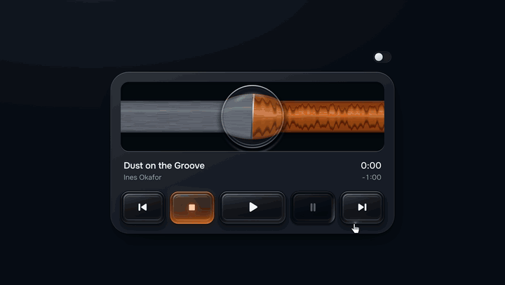

# Glass player

Follow [@sebastianbennis on X](https://x.com/sebastianbennis) to see each new one first.



A music player whose queue is one ribbon running under a fixed lens of thick glass, with five glass keys: back, stop, play, pause and forward. The ribbon can be taken in the hand: drag it and the music under the lens plays at the speed and in the direction of your hand, like tape pulled across a head. Press Stop and the song runs all the way back to its start under the glass.

It needs React 18 or newer and nothing else. There is no build step, no CSS framework, no icon set and no image. The ribbon, the lens and the keys are drawn in code with WebGL2, with a plain canvas and CSS keys for browsers that lack it.

It plays your own audio files through an ordinary `<audio>` element. No audio comes with it.

## Install

```bash
# npm
npx shadcn@latest add sebastianbennis/beautiful-ui/glass-player

# pnpm
pnpm dlx shadcn@latest add sebastianbennis/beautiful-ui/glass-player

# Yarn
yarn dlx shadcn@latest add sebastianbennis/beautiful-ui/glass-player

# Bun
bunx --bun shadcn@latest add sebastianbennis/beautiful-ui/glass-player
```

The files land in `components/glass-player`, or `src/components/glass-player` if your project has a `src` folder. You don't need shadcn/ui or Tailwind.

To do it by hand, copy everything in the [`src`](./src) folder into a folder called `glass-player` in your project. Either way, the code is yours to change.

## Use it

To see it move before you have any audio, leave `src` out. A track with no file runs silently on the player's own clock, and every key, the ribbon and the keyboard work the same:

```tsx
import { GlassHead } from './components/glass-player';

export function NowPlaying() {
  return (
    <GlassHead
      tracks={[
        { title: 'First piece', artist: 'Someone', duration: 84 },
        { title: 'Second piece', artist: 'Someone', duration: 112 },
      ]}
    />
  );
}
```

With real files, give each track its `src`, its length in seconds, and a colour if you want one:

```tsx
import { useRef, useState } from 'react';
import { GlassHead, type GlassHeadHandle, type GlassHeadState } from './components/glass-player';

export function NowPlaying() {
  const player = useRef<GlassHeadHandle>(null);
  const [state, setState] = useState<GlassHeadState>('stopped');
  const [index, setIndex] = useState(0);

  return (
    <>
      <GlassHead
        ref={player}
        label="Morning set"
        tracks={[
          { src: '/audio/kelp-forest.m4a', title: 'Kelp Forest, 6 a.m.', artist: 'Ines Okafor', duration: 84, tint: '#e8743b' },
          { src: '/audio/night-bus.m4a', title: 'Night Bus to Almada', artist: 'Tomasz Wren', duration: 112, tint: '#34b9a5' },
        ]}
        onStateChange={setState}
        onTrackChange={setIndex}
      />
      <p>
        Track {index + 1} is {state}.
      </p>
      <button type="button" onClick={() => player.current?.seek(30)}>
        Go to 0:30
      </button>
    </>
  );
}
```

The tracks can be written inline like this. The player only loads the queue again when a file, a length, a colour or the peaks have changed, so your own state can change as often as it likes without the music being touched.

## The components

There is one component, `GlassHead`. It is the ribbon, the lens, the title, the time and the five keys together.

| Prop | What it does |
| --- | --- |
| `tracks` | Required. The queue, in order. Each track is described below. |
| `theme` | `'light'` or `'dark'`. Left out, it follows the system. See Theme below. |
| `span` | Seconds of music visible across the window. Default 14. A larger number shows more of the song and makes the ribbon move more slowly. |
| `renderer` | `'2d'` skips WebGL: a plain canvas ribbon, and keys drawn in CSS. The same version is used on its own when WebGL2 is missing. Default `'auto'`. |
| `scrubSound` | Dragging or throwing the ribbon plays the music under the lens at the speed and in the direction it passes. Default `true`. `false` keeps the ribbon silent in the hand. |
| `label` | The accessible name of the player. Default "Player". |
| `onStateChange(state)` | Called with `'stopped'`, `'playing'` or `'paused'` when it changes. |
| `onTrackChange(index)` | Called with the track's place in the list when it changes. |
| `className` | Added to the root element, beside `glasshead`. |

A track:

| Field | What it is |
| --- | --- |
| `title` | Required. Shown under the ribbon. A long one is cut with an ellipsis. |
| `duration` | Required. Length in seconds. The ribbon is laid out from this, so it should match the file. |
| `src` | The audio file, anything the browser's `<audio>` can play. Leave it out and the track runs silently on the player's clock. |
| `artist` | Shown under the title. |
| `tint` | Any CSS colour. The track's stretch of ribbon and the lit key take it. Without one, tracks take turns through four built-in colours. |
| `peaks` | Loudness over time as numbers from 0 to 1, any length. It shapes the relief on the ribbon. Without it the file is fetched, decoded and measured in the browser. |

A ref gives you the transport:

```tsx
const player = useRef<GlassHeadHandle>(null);

<GlassHead ref={player} tracks={tracks} />;

player.current?.play();
player.current?.pause();
player.current?.stop();      // back to the start of the current track
player.current?.back();
player.current?.forward();
player.current?.select(2);   // jump to the third track
player.current?.seek(30);    // 30 seconds into the current track
```

Also exported: the types `GlassHeadProps`, `GlassHeadHandle`, `GlassHeadState` and `GlassHeadTrack`.

What someone sees as they use it:

| Moment | What happens |
| --- | --- |
| At rest | The ribbon sits at the start of the track under the lens, and Stop is the lit key. |
| The pointer comes over it | The gloss on the lens moves with the pointer. The key under it rises a little off the deck, and the shoulder facing the pointer catches its light. |
| A key is pressed | It sinks on a spring into its seat, leans a touch toward the finger, and its icon rides down with it. A tap shorter than the key's travel still takes it down. |
| Play | The ribbon glides from right to left. Ribbon that has passed the lens is glossy and saturated, and ribbon still to come is frosted. |
| A key lights | The key for the current state stays half way down and carries the track's colour inside the glass. The colour arrives at the point that was touched and spreads to the edges. |
| Pause | The ribbon holds exactly where it is, and Pause is lit. |
| Stop | The ribbon steps a hair forward, then runs all the way back to the start of the song, smearing as it goes, and lands with a small overshoot. |
| Back, forward | The ribbon flicks to the neighbouring track's start and the colour under the lens changes. Back goes to the start of this track, or to the previous track within the first 3 seconds. |
| The ribbon is dragged | It follows the hand, and the music under the lens plays at the hand's speed: slow is low and quiet, fast is high, and pulling back plays it backwards. |
| It is thrown | It keeps its momentum and settles. The music picks up exactly where it lands. |
| A track ends | The join passes under the lens and the next track's colour arrives. After the last track the ribbon runs back to the first and stops. |
| A file is slow to load | The lit key breathes slowly until the sound starts. |
| A file cannot play | The player pauses and the line under the title reads "Can't play this file". Play tries it again. |
| A key cannot be used | Pause while stopped, and Forward on the last track, sit lower and darker with a dim icon. |

## Theme

Dark is smoked glass on a blue-black deck, where the glass shows by its highlights. Light is clear glass on porcelain, where it shows by its shadows. Each is drawn on its own terms.

```tsx
<GlassHead tracks={tracks} theme="light" />
```

Leave `theme` out and it follows the system setting, and changes with it. To let people choose:

```tsx
const [theme, setTheme] = useState<'light' | 'dark'>('dark');

<button type="button" onClick={() => setTheme(theme === 'dark' ? 'light' : 'dark')}>
  {theme === 'dark' ? 'Use light' : 'Use dark'}
</button>
<GlassHead tracks={tracks} theme={theme} />
```

The player draws its own deck. Give the page behind it a background of your own.

## Make it yours

Set these custom properties on `.glasshead`, with your own rule. Every default carries no specificity, so any rule of yours wins. Colours can be in any CSS format.

```css
.my-app .glasshead {
  --glasshead-unit: 6px;
  --glasshead-deck: #2f3a24;
  --glasshead-deck-hi: #46552f;
  --glasshead-well: #1b2214;
  --glasshead-ink: #f3ecd2;
  --glasshead-ink-soft: #b9b48f;
}
```

| Token | What it colours or sets |
| --- | --- |
| `--glasshead-unit` | The size of the whole player. Default 8px. See Size below |
| `--glasshead-deck` | The slab the player is made of |
| `--glasshead-deck-hi` | The lit corner of the slab, top left |
| `--glasshead-well` | The window behind the ribbon |
| `--glasshead-ink` | The title, the time and the icons |
| `--glasshead-ink-soft` | The artist and the time left |
| `--glasshead-warn` | The line "Can't play this file" |
| `--glasshead-edge-hi`, `--glasshead-edge-lo`, `--glasshead-edge` | The bright, dark and faint lines along the edges of the slab and the window |
| `--glasshead-shade-1`, `--glasshead-shade-2`, `--glasshead-shade-3` | The three layers of shadow under the slab, from tight to wide, and the shadow under each icon |
| `--glasshead-ease`, `--glasshead-ease-press` | The curves the CSS keys and the colour changes move on |
| `--glasshead-key-fill`, `--glasshead-sheen`, `--glasshead-lit`, `--glasshead-lit-ink` | The CSS keys used without WebGL2: their fill, their gloss, the light in the lit one and its icon |

The deck, ink and edge tokens have their own defaults in the light theme. Set one of them on `.glasshead` and it applies in both. For a different value in light only, set it under `.glasshead[data-theme='light']`, or inside a `prefers-color-scheme: light` query if you leave `theme` out.

**Colour.** The colour in the player belongs to the music. Each track's stretch of ribbon, the lit key and the focus rings take that track's `tint`, so set colours on the tracks, not in CSS.

**The glass.** The lens and the keys are drawn by shaders as one of two materials, smoked or clear, and the glass itself has no colour token. It sits over your deck, so it takes on the deck's colour through it. Choose the theme that matches your deck: `dark` for a dark deck and `light` for a pale one.

**Size.** One length sizes everything: the keys, the window, the corners, the gaps and the text. Set `--glasshead-unit` to 5px for a sidebar or 11px for a hero. The player fills the width you give it up to 70 units, which is 560px at the default, and the keys share that width. To let it grow wider, give `.glasshead` a `max-width` of your own.

**Type.** Text uses your page's font. Times are set in tabular figures so they don't shift as they count.

**Words.** The labels are plain strings in `GlassHead.tsx`. Change them there.

**Motion.** With reduced motion on, Stop and the skips cross-fade to the new place with no travel or smear, the gloss stays still, and the keys go straight to their place with no spring. Every state still appears.

**Keyboard.** Every key is a real button with a label and a visible focus ring, and Space or Enter presses it. A key pressed from the keyboard sinks and lights the same way, with the colour spreading from its centre. The ribbon is a slider: the arrows move 5 seconds, Page Up and Page Down 15, and Home and End go to the ends of the track. Space anywhere else on the player toggles play.

**The sound in the hand.** While the ribbon is held, the sound runs a moment behind the hand, long enough for each pointer report to have arrived, so its speed and direction stay exact. That moment is measured on every press, so it adapts to the device: a few milliseconds on built-in speakers, around a fifth of a second on wireless headphones. It needs an `AudioWorklet`, so the page must be served over https or from localhost. Without one the ribbon is silent in the hand and everything else works. Files over 15 minutes are not decoded for it.

**Files on another domain.** The music itself plays from anywhere an `<audio>` element can reach. To draw the relief and to play the ribbon in the hand the file is also fetched and decoded, and that needs the other domain to allow it with CORS headers. Without them the music still plays, the ribbon has an even relief and it is silent in the hand. Passing your own `peaks` brings the relief back.

**No WebGL2.** The ribbon is drawn on a plain canvas with a lens that magnifies but does not bend light, and the keys are drawn in CSS: flat slabs that sink when pressed, with the colour rising from the foot of the lit one. Everything else is the same.

**Speed.** It draws only while something moves. A stopped or paused player with no pointer near it costs nothing.

**More than one.** Each player has its own audio element and its own clock, so several can sit on one page. They don't know about each other: starting one does not stop another.

**Files.** `GlassHead.tsx` is the entry point and `glasshead.css` its styles. `engine.ts` is the transport and its clock. `ribbon.ts` draws the ribbon and the lens with WebGL2, and holds the plain canvas version. `keys.ts` draws the glass keys. `scrub.ts` is the sound of the ribbon in the hand, an audio worklet kept as text so there is no extra file to serve. `peaks.ts` measures a file's loudness, and `icons.tsx` holds the five icons.
