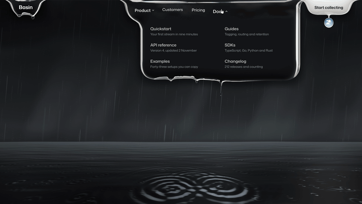

# Liquid navbar

Follow [@sebastianbennis on X](https://x.com/sebastianbennis) to see each new one first.



A navigation bar made of black liquid, built into the banner it hangs over. Every drip falls through the rain and lands on the sea at the foot of the banner, leaving rings and raising the water. A small drop switches the storm to a clear sunny day, where the navigation turns to cloud.

It needs React 18 or newer and nothing else. There is no build step, no CSS framework, no icon set and no image or video. Everything is drawn in code with WebGL2, on desktop and phone.

## Install

```bash
# npm
npx shadcn@latest add sebastianbennis/beautiful-ui/liquid-navbar

# pnpm
pnpm dlx shadcn@latest add sebastianbennis/beautiful-ui/liquid-navbar

# Yarn
yarn dlx shadcn@latest add sebastianbennis/beautiful-ui/liquid-navbar

# Bun
bunx --bun shadcn@latest add sebastianbennis/beautiful-ui/liquid-navbar
```

The files land in `components/liquid-navbar`, or `src/components/liquid-navbar` if your project has a `src` folder. You don't need shadcn/ui or Tailwind.

To do it by hand, copy everything in the [`src`](./src) folder into a folder called `liquid-navbar` in your project. Either way, the code is yours to change.

## Use it

Put it at the top of your page. By default it fills the first screen.

```tsx
import { Pendant } from './components/liquid-navbar';

<Pendant
  brand={<span>Fieldnote</span>}
  action={{ label: 'Start free', href: '/signup' }}
  defaultActiveId="product"
  items={[
    {
      id: 'product',
      label: 'Product',
      icon: <ProductIcon />,
      links: [{ id: 'reports', label: 'Reports', detail: 'Read every reply in one place', href: '/reports' }],
    },
    { id: 'pricing', label: 'Pricing', icon: <PriceIcon />, href: '/pricing' },
  ]}
/>;
```

An item with `links` opens a panel on desktop and a sheet on a phone. An item with `href` is a plain link. `icon` only shows on the phone bar, so give it a 24 by 24 SVG that uses `currentColor`.

## The components

There is one component, `Pendant`. It is the navigation and the banner together, so there is nothing else to place.

| Prop | What it does |
| --- | --- |
| `items` | The navigation. Each has `id`, `label`, and `href` or `links`. `icon` and `disabled` are optional. |
| `activeId` | Controls the current page. Leave it out and use `defaultActiveId` to let the nav track it. |
| `onNavigate(itemId, linkId?)` | Called when someone picks an item or a link. |
| `brand`, `brandHref`, `brandLabel` | The left form, where it goes and its spoken name. |
| `action` | The button: `label`, and `href` or `onSelect`. Pressing it also calls lightning, or a flare of sun in clear weather. |
| `fog` | Mist on the liquid behind the titles, which the pointer wipes away. The titles stay sharp. On by default. |
| `defaultWeather` | The theme it starts in: `'storm'` (dark, the default) or `'clear'` (light). |
| `weather` | Controls the theme yourself. Leave it out and the drop changes it. |
| `onWeatherChange(weather)` | Called when someone asks for the other weather. |
| `weatherToggle` | Shows the drop that holds the other weather. On by default. |
| `children` | Anything you want standing in the storm. It sits behind the liquid and the water. |
| `breakpoint` | Below this width in pixels it uses the phone layout. Default 900. Raise it if your labels are long enough to crowd the bar. |
| `label` | The accessible name of the navigation landmark. Default "Main". |
| `linkAs` | Renders links with your router, for example `next/link`. |
| `className`, `style` | Passed to the root element. |

The types are in `types.ts`.

What it does when someone uses it:

| Action | What happens |
| --- | --- |
| Move near the bar | The liquid leans toward the pointer before it arrives. |
| Hover a title | A drop swells under it and the fog behind the word clears. The word itself never blurs. |
| Click a title | A large drop lets go and falls to the water. |
| Hold a title | It pours in one unbroken stream to the water, then parts into beads on release. |
| Hover an item with links | Its panel opens. |
| Move over the water | Rings trail behind the pointer. |
| Click the water | A stone drops in. |
| Press the button | Lightning lights every ring on the water. In clear weather a flare of sun runs along it. |
| Press the small drop | It falls, lands in the water, and the other weather spreads out from where it went in. |
| Drag along the phone tabs | The liquid follows the thumb. Pull up on an item with links to raise its sheet. |

## Theme

It starts in the storm, which is the dark theme. Clear weather is the light theme, designed on its own terms rather than inverted: the black liquid becomes cloud, the sea turns blue and the sun lies on it.

```tsx
<Pendant items={items} defaultWeather="clear" />
```

To hold the weather in your own app, for example to remember someone's choice:

```tsx
const [weather, setWeather] = useState<PendantWeather>('storm');

<Pendant items={items} weather={weather} onWeatherChange={setWeather} />;
```

Set `weatherToggle={false}` to hide the drop.

## Make it yours

Set these custom properties on `.pd`, with your own rule or the `style` prop. Every default carries no specificity, so any rule of yours wins. Colours can be in any CSS format. The liquid, the sky and the water read them once when the banner mounts, so set them in your stylesheet rather than changing them afterwards.

```css
.my-site .pd {
  --pd-surface: #10233f;
  --pd-light: #e4edff;
  --pd-sky: #060d1a;
  --pd-glow: #93b4ff;
  --pd-action: #ffd166;
  --pd-action-ink: #1c1500;
}
```

| Token | What it colours or sets |
| --- | --- |
| `--pd-sky` | The darkest part of the storm |
| `--pd-glow` | Rain, cloud and the light on the horizon. It also tints the water |
| `--pd-surface` | The liquid itself |
| `--pd-light` | Reflections on the liquid |
| `--pd-ink`, `--pd-ink-dim` | Text, and quieter text |
| `--pd-action`, `--pd-action-ink` | The button and its label. Its colour also lands on the water |
| `--pd-scrim` | The dark layer behind a phone sheet |
| `--pd-unit` | One length that scales the whole set. Default 16px |
| `--pd-height` | The height of the banner. Default 100svh |
| `--pd-font` | The font. By default it inherits yours |

Clear weather has its own set.

| Token | What it colours |
| --- | --- |
| `--pd-day-sky`, `--pd-day-haze` | The sky overhead, and the pale band near the horizon |
| `--pd-day-cloud`, `--pd-day-shade` | Cloud in the sun, and cloud in its own shadow |
| `--pd-day-water` | The water close up |
| `--pd-day-ink`, `--pd-day-ink-dim` | Text on the clouds, and quieter text |
| `--pd-day-action`, `--pd-day-action-ink` | The button in clear weather and its label |
| `--pd-day-scrim` | The layer behind a phone sheet |

**Size.** `--pd-unit` resizes the whole set in proportion, and `--pd-height` sets how tall the banner is. It chooses between the desktop and phone layouts from its own width, so it also works inside a narrower container.

**Type.** Text uses your page's font. Set `--pd-font` to change it.

**Motion.** `--pd-enter` and `--pd-exit` are the curves for the panels and labels. With reduced motion on, the rain, the drips and the lightning stop and you get a composed still scene. The navigation still works and the weather changes at once.

**Keyboard.** On desktop, arrows move through a panel and Escape closes it and returns focus. On the phone layout, Enter opens the sheet, focus stays inside until you close it, and Escape closes it.

**No WebGL.** It falls back to a plain bar with the same links, and a sun or cloud icon switches between a dark and a light version.

**Speed.** It lowers its own drawing resolution if a machine can't hold its frame rate, raises it again when the slowdown passes, and stops when the tab is hidden.

**Haptics.** Android only. iPhones don't offer them to web pages.

**Files.** `Pendant.tsx` is the entry point. `Bar.tsx` is the desktop layout and `Mound.tsx` the phone layout. `engine.ts` runs the physics and drawing. `shader.ts` draws the liquid, the clouds and the drop, `water.ts` the water, `weather.ts` the sky and `daylight.ts` holds the edge between the two weathers.
