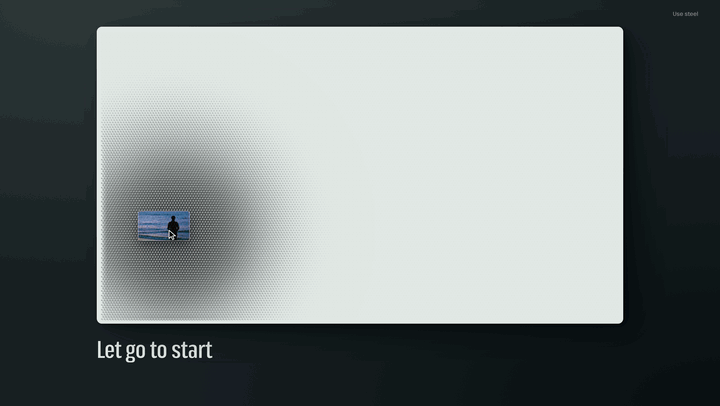

# Pin upload

Follow [@sebastianbennis on X](https://x.com/sebastianbennis) to see each new one first.



A drag and drop upload for huge video files, made of one plate of thousands of pins. The pins stand as high as the bytes that have landed, so the film presses up in relief while it sends. When the last part lands, colour rides out across the plate, the pins sink and the plate becomes the video.

It needs React 18 or newer and nothing else. There is no build step, no CSS framework, no icon set and no image. The pins are drawn in code with WebGL2, with a 2D canvas for browsers that lack it.

The upload engine comes with it: parts, six at a time, retries, a lost connection, pause, and carrying on after a reload. You give it one function that sends one part.

## Install

```bash
# npm
npx shadcn@latest add sebastianbennis/beautiful-ui/pin-upload

# pnpm
pnpm dlx shadcn@latest add sebastianbennis/beautiful-ui/pin-upload

# Yarn
yarn dlx shadcn@latest add sebastianbennis/beautiful-ui/pin-upload

# Bun
bunx --bun shadcn@latest add sebastianbennis/beautiful-ui/pin-upload
```

The files land in `components/pin-upload`, or `src/components/pin-upload` if your project has a `src` folder. You don't need shadcn/ui or Tailwind.

To do it by hand, copy everything in the [`src`](./src) folder into a folder called `pin-upload` in your project. Either way, the code is yours to change.

## Use it

To see it move before you have a server, give it a sender that only pretends:

```tsx
import { PinBed, type UploadPartFn } from './components/pin-upload';

const pretend: UploadPartFn = (part, signal, onBytes) =>
  new Promise((resolve, reject) => {
    let sent = 0;
    const timer = window.setInterval(() => {
      sent += part.size / 4;
      onBytes(Math.min(sent, part.size));
      if (sent >= part.size) {
        window.clearInterval(timer);
        resolve();
      }
    }, 70);
    signal.addEventListener('abort', () => {
      window.clearInterval(timer);
      reject(new DOMException('Aborted', 'AbortError'));
    }, { once: true });
  });

export function NewUpload() {
  return <PinBed uploadPart={pretend} partSize={(file) => Math.ceil(file.size / 150)} />;
}
```

Drop any video on it. `partSize` is set here only so a small test file is cut into enough parts to sweep across the plate.

For a real upload, `uploadPart` sends one part and resolves when your server has it. This one puts each part to a signed URL and reports the bytes as they leave:

```tsx
import { PinBed, PinBedOffline, type UploadPartFn } from './components/pin-upload';

function put(url: string, body: Blob, signal: AbortSignal, onBytes: (sent: number) => void) {
  return new Promise<void>((resolve, reject) => {
    const request = new XMLHttpRequest();
    request.open('PUT', url);
    request.upload.onprogress = (event) => onBytes(event.loaded);
    request.onload = () => (request.status < 300 ? resolve() : reject(new Error(`The server answered ${request.status}`)));
    request.onerror = () => reject(new PinBedOffline());
    request.onabort = () => reject(new DOMException('Aborted', 'AbortError'));
    signal.addEventListener('abort', () => request.abort(), { once: true });
    request.send(body);
  });
}

const uploadPart: UploadPartFn = async (part, signal, onBytes) => {
  const answer = await fetch(`/api/uploads/sign?name=${encodeURIComponent(part.file.name)}&part=${part.index}`, { signal });
  const { url } = (await answer.json()) as { url: string };
  await put(url, part.blob(), signal, onBytes);
};

export function NewUpload() {
  return (
    <PinBed
      uploadPart={uploadPart}
      linkFor={(file) => `https://example.com/v/${encodeURIComponent(file.name)}`}
      onDone={(file) => console.log(`${file.name} is up`)}
    />
  );
}
```

`part` gives you `index`, `start`, `end`, `size`, the `file`, and `blob()` for the bytes. The kit keeps nothing your server hands back, so hold what you need from each part, such as an ETag, in your own function, and use `onDone` to tell your server the file is complete.

## The components

There is one component, `PinBed`. It is the drop area, the progress and the player together, so there is nothing else to place.

| Prop | What it does |
| --- | --- |
| `uploadPart` | Required. Sends one part: `(part, signal, onBytes) => Promise<void>`. Call `onBytes(sent)` as the part goes out, and the pins rise with it. |
| `theme` | `'chalk'` (light, the default) or `'steel'` (dark). See Theme below. |
| `page` | `'light'` or `'dark'`: what the plate sits on, so the words and buttons match. Light for chalk and dark for steel unless you say otherwise. |
| `workers` | How many parts are sent at once. Default 6. |
| `partSize` | Bytes per part, as a number or a function of the file. By default a part is 16 MiB or more, a huge file is cut into 180 to 360 parts, and the count always stays under the 10,000 that S3 allows. |
| `videoFor(file)` | Where the finished film plays from. By default it plays the file on the person's own disk, so nothing has to be fetched. |
| `linkFor(file)` | The link that "Copy link" copies. Leave it out and that button is not shown. |
| `onDone(file)` | Called when a file has finished. |
| `tabTitle` | While a file sends, the browser tab shows the time left, then "Ready", so it can be read from another tab. Your own title comes back when the plate is cleared. `false` leaves the title alone. |
| `maxPixels` | The most pixels the plate may draw, read when it mounts. The default, 3.4 million, keeps a very large plate just under 2x. Lower it for slow devices. |
| `now(file)` | Replaces the clock used for the time left, in milliseconds. For tests. |
| `idleActions` | Your own controls next to "Choose a file", shown while the plate is empty. |
| `className`, `style` | Passed to the root element. |

A ref gives you two methods:

```tsx
const bed = useRef<PinBedHandle>(null);

<PinBed ref={bed} uploadPart={uploadPart} />;

bed.current?.add(files);                       // start files you already have
bed.current?.add(files, { remember: false });  // the same, without keeping a note for after a reload
bed.current?.reset();                          // stop everything and clear the plate
```

Also exported: `PinBedOffline`, and the types `PinBedProps`, `PinBedHandle`, `PinBedTheme`, `UploadPart` and `UploadPartFn`.

What someone sees as they use it:

| Moment | What happens |
| --- | --- |
| A file is carried into the window | Every pin moves once. The plate has noticed. |
| It is held over the plate | The pins rise under it and follow it, and the line reads "Let go to start". Under a file that is not a video they dip instead, and the line reads "Only video files". |
| It is let go | A ring leaves the point where it landed, harder for a bigger file. A ridge runs while the first frame is read from the person's own disk. |
| While it sends | Each column of pins rises as its bytes land, so the film presses up from left to right. The time left updates once a second. |
| A part fails | Its column stays flush, a clean gap in the picture, until the retry lands. |
| The pointer crosses the plate | A low hill follows the hand, and pressing pushes it down. |
| Cancel is hovered or focused | The standing picture sags a little. |
| Cancel, then Discard | It asks first, "Discard 12.40 GB?". On Discard the pins fall flat in a wave that starts at the button. |
| Pause | The plate holds still and says how much is safe. "Keep sending" carries on. |
| The connection drops | "Connection lost", how much is safe, and a countdown to the next try. |
| The last part lands | One ring leaves that column and colour rides out on it, pin by pin. The pins sink into the frame they were showing, and only then does the film start to move. |
| It is done | A transport made of one row of pins, with play, pause and a scrubber, then "Send another" and "Copy link". |
| Several files or a folder | They queue and send one at a time. A list under the plate shows each one on a small bed of its own, and picking a row puts that file on the plate. |
| The page is reloaded | The plate stands where it was and asks for the same file, then carries on from there. |

How the engine treats trouble:

- **A part that fails** goes to the back of the line and waits 1, 2, 4, 8, 16 and then 30 seconds between tries, while the others carry on. Any rejection from `uploadPart` counts as that part failing.
- **A lost connection** is different: everything stops, nothing is counted as a failure, and it tries again after 1, 2, 4, 8 and then every 12 seconds, or at once when the browser says it is back online. Reject with `PinBedOffline` to say the network is gone. A `TypeError`, which is what `fetch` throws when the network fails, counts the same way.
- **A server that refuses everything** stops the upload: when only failing parts are left after six tries each, or 18 fail in a row with nothing landing. The plate keeps what is safe and offers "Try again".
- **A reload** loses nothing that was confirmed. Parts are remembered in `localStorage` by the file's name, size and modified date, under keys that start with `pinbed:`. The kit then skips those parts, so your server needs to still hold them. With S3 you can list the parts it has.

## Theme

Chalk is the light theme and steel is the dark one. Each is designed on its own terms: in chalk the picture is made of the pins' shadows, and in steel it is made of glints on their tips.

```tsx
<PinBed uploadPart={uploadPart} theme="steel" />
```

Change `theme` while it is on screen and the plate does not flip. A front leaves the point that was pressed, or the focused control when the keyboard was used, and each pin turns over as it passes.

```tsx
const [theme, setTheme] = useState<PinBedTheme>('chalk');

<button type="button" onClick={() => setTheme(theme === 'chalk' ? 'steel' : 'chalk')}>
  {theme === 'chalk' ? 'Use steel' : 'Use chalk'}
</button>
<PinBed uploadPart={uploadPart} theme={theme} />
```

The preview shows the chalk plate on a dark page. For that, set `page="dark"` and give the page behind it a dark background of your own.

## Make it yours

Set these custom properties on `.pinbed`, with your own rule or the `style` prop. Every default carries no specificity, so any rule of yours wins. Colours can be in any CSS format. The pins read their colours when the plate mounts, when it is resized and when the theme changes, so set them in your stylesheet.

```css
.my-app .pinbed {
  --pinbed-chalk: #f0dcc0;
  --pinbed-graphite: #4a1420;
  --pinbed-shade: #8a5a48;
  --pinbed-glint: #fff6e6;
  --pinbed-blued: #2a1a12;
  --pinbed-oxide: #b3261e;
  --pinbed-radius: 4px;
}
```

| Token | What it colours or sets |
| --- | --- |
| `--pinbed-chalk` | The chalk plate and its pins |
| `--pinbed-graphite` | The deepest shadow, and the words and the lead button on a light page |
| `--pinbed-shade` | Softer shadow and quieter text |
| `--pinbed-glint` | The highlight on a pin's head |
| `--pinbed-blued` | The steel plate |
| `--pinbed-oxide` | The word "Discard" |
| `--pinbed-ink`, `--pinbed-ink-soft` | Text, and quieter text |
| `--pinbed-button`, `--pinbed-button-ink` | The plain buttons and their labels |
| `--pinbed-lead`, `--pinbed-lead-ink` | The main button and its label |
| `--pinbed-drop` | The shadow under the buttons |
| `--pinbed-radius` | The plate's corners. Default 14px |
| `--pinbed-pin` | The distance between pins on a wide plate. Default 7.2px |
| `--pinbed-ease`, `--pinbed-lift` | The curves the buttons and the transport move on |

The ink, button, lead and drop tokens have their own defaults on a dark page and in steel. Set one of them on `.pinbed` and it applies everywhere. For a different value on a dark page or in steel, set it under `.pinbed[data-page='dark']` or `.pinbed[data-theme='steel']`.

**Size.** The plate fills the width you give it and keeps a 16:9 shape. The words scale with the kit's own width, not the window's, and under 560px the buttons move below the words and fill the row, so it works in a narrow column as well as across a page. `--pinbed-pin` sets how far apart the pins sit on a wide plate. A narrower plate uses finer pins, down to 4.4px, so the picture keeps its detail.

**Type.** Text uses your page's font. The large line asks for a condensed width, which shows if your font has a width axis.

**Words.** The labels are plain strings in `PinBed.tsx` and `Transport.tsx`. Change them there.

**Motion.** With reduced motion on, the pins take their heights at once, the theme changes at once and nothing travels. Every state still appears. The setting is read when the plate mounts.

**Keyboard.** The plate is a button: Enter or Space opens the file picker. Every control has a visible focus ring, focus stays in the row when the buttons change, and Escape takes back the "Discard?" question. The scrubber is a real range input, and the status line is announced to screen readers.

**Files it takes.** Anything the browser calls a video, plus these by name: mp4, mov, m4v, mxf, braw, r3d, mkv, webm, avi, mts, m2ts, mpg, mpeg, ts, wmv and ogv. When the browser cannot decode a file, ProRes in Chrome for example, the pins rise to a skyline of the file's data rate instead, read from the frame-size table of a QuickTime or MP4 container without decoding anything. A file with no such table gets an even slab. Either way the upload itself is the same, and the plate ends on "Ready" with the pins standing.

**No WebGL2.** It falls back to a 2D canvas of pre-drawn pins that repaints only the columns that changed. The theme changes at once there.

**Speed.** It draws only when something moves, and only the band of the plate that changed, so a four hour upload costs almost nothing while you wait.

**One per page.** It listens for files dragged anywhere in the window and keeps one note for carrying on after a reload, so it is made to be the only upload on a page.

**Files.** `PinBed.tsx` is the entry point and `pinbed.css` its styles. `upload.ts` is the upload engine. `field.ts` holds every pin's height, `bed.ts` joins it to the canvas, `renderer.ts` and `shader.ts` draw it with WebGL2, and `fallback.ts` draws it without. `picture.ts` reads the first frame or the data rate. `Transport.tsx` is the player's controls and `MiniBed.tsx` the small beds in the queue.
